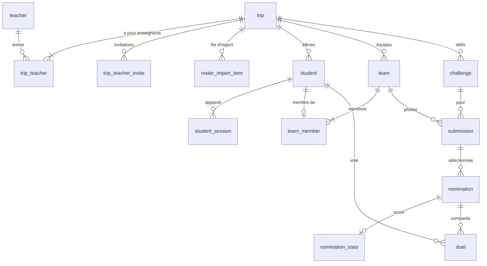
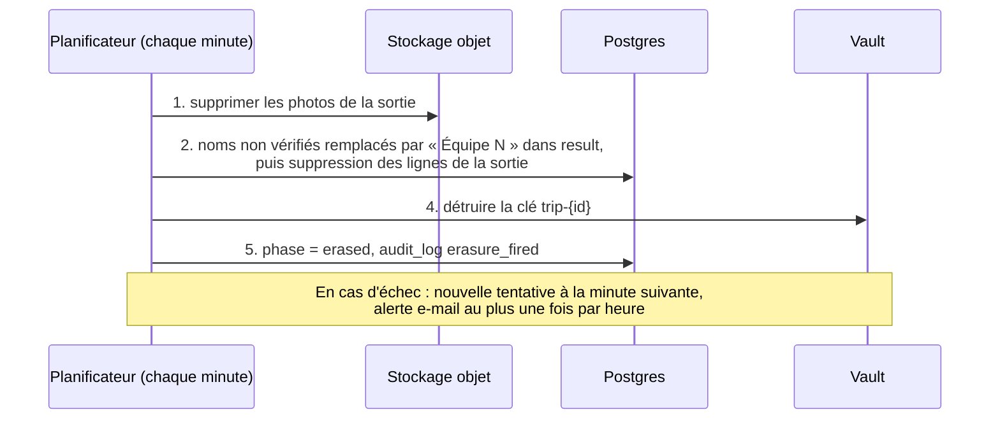
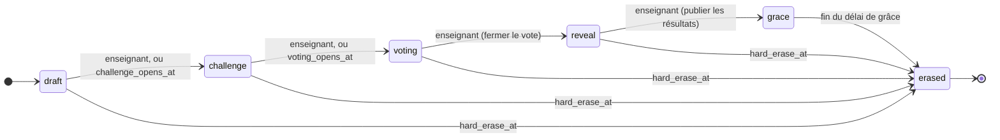

# Modèle de données

Conception du schéma de Trip Challenges, dérivée de `CONTEXT.md` et des ADR. Postgres
pour les données relationnelles, MinIO pour les fichiers photo, Vault (transit) pour les
clés par sortie. Ce ne sont pas les migrations : c'est le contrat que le code met en
œuvre. Les noms de tables, de colonnes et de valeurs restent ceux du code (en anglais).

Notation : 🔒 = chiffré au repos sous la **clé de la sortie** (clé Vault transit
`trip-<tripId>`) ; détruire cette clé efface cryptographiquement toutes les valeurs 🔒
(ADR-0001). Les colonnes en clair ne sont pas des données personnelles et survivent à
l'effacement.

## Vue d'ensemble

`result` et `audit_log` n'ont pas de clé étrangère vers `trip` : ils survivent à
l'effacement.

---

## Global (non rattaché à une sortie, persiste d'une sortie à l'autre)

### teacher
Identité du personnel, issue de PocketID (OIDC). Couvre plusieurs sorties ; sous aucune
clé de sortie.

| colonne | type | remarques |
|---|---|---|
| id | uuid pk | |
| oidc_subject | text unique | `sub` PocketID ; l'ancrage réel de l'identité |
| email | citext | e-mail du personnel (pas un mineur) |
| display_name | text | |
| created_at | timestamptz | |

---

## Rattaché à une sortie

Chaque table ci-dessous porte `trip_id uuid` (FK → trip) et est filtrée par cette colonne
à chaque requête (isolation entre sorties, de nombreuses sorties pouvant être
simultanées).

### trip
| colonne | type | remarques |
|---|---|---|
| id | uuid pk | |
| name | text | |
| owner_teacher_id | uuid fk→teacher | créateur/responsable |
| max_team_size | int | 4 par défaut |
| points_table | jsonb | `[{placement:1,points:5},{2,3},{3,1}]`, modifiable |
| phase | text enum | `draft \| challenge \| voting \| reveal \| grace \| erased` |
| challenge_opens_at | timestamptz | prévue |
| voting_opens_at | timestamptz | prévue |
| voting_closes_at | timestamptz | prévue |
| grace_days | int | 7 par défaut : durée entre la publication des résultats et l'effacement |
| trip_end_date | date | pour la date butoir |
| max_retention_days | int | 30 par défaut |
| grace_started_at | timestamptz null | publication des résultats (passage `reveal → grace`) ; le délai de grâce part de là (0004) |
| hard_erase_at | timestamptz | = trip_end_date + max_retention_days ; effacement forcé quelle que soit la phase |
| vault_key_name | text | `trip-<id>` ; simple référence, la clé vit dans Vault |
| created_at | timestamptz | |

`teams_locked` découle de `phase >= challenge` (rejoindre et quitter se figent au début
des défis). Créer une équipe reste possible pendant `challenge`, pour qu'un élève sans
équipe puisse jouer en solo dans une équipe d'une personne (#79). À partir de `voting`,
plus rien ne change.

### trip_teacher — appartenance des co-enseignants
| colonne | type | remarques |
|---|---|---|
| trip_id | uuid fk | |
| teacher_id | uuid fk | |
| role | text enum | `owner \| co` |
| pk | (trip_id, teacher_id) | |

### trip_teacher_invite — invitations de co-enseignants en attente
| colonne | type | remarques |
|---|---|---|
| id | uuid pk | |
| trip_id | uuid fk | |
| email | citext | collègue invité (personnel) |
| token_hash | text | à usage unique |
| expires_at | timestamptz | 7 jours après l'invitation |
| accepted_at | timestamptz null | rattachée à l'enseignant lors de sa connexion PocketID |

### student — un participant mineur, unique par sortie
| colonne | type | remarques |
|---|---|---|
| id | uuid pk | |
| trip_id | uuid fk | |
| email_enc 🔒 | bytea | chiffré par Vault ; la seule donnée personnelle de l'élève |
| email_lookup | text | HMAC(email) sous une clé MAC propre à la sortie, pour dédoublonner/retrouver sans déchiffrer |
| access_code_hash | text | argon2id du code à usage unique de 128 bits ; jamais stocké en clair |
| access_code_state | text enum | `unredeemed \| redeemed \| reissued` |
| access_code_sent_at | timestamptz null | le code courant a bien été envoyé par e-mail (0002) |
| created_at | timestamptz | |

Même e-mail dans deux sorties = deux lignes dans deux sorties, avec des `email_lookup`
différents (clés MAC différentes). Aucune jointure entre sorties n'est possible.

### student_session — session liée à l'appareil
| colonne | type | remarques |
|---|---|---|
| id | uuid pk | |
| student_id | uuid fk | |
| token_hash | text | `sha256:<hex>` du jeton d'appareil de 256 bits (#64) ; les anciens hachages argon2 sont convertis à la première utilisation |
| created_at | timestamptz | |
| revoked_at | timestamptz null | renseigné quand un nouveau code est émis puis utilisé (invalide la session précédente) |

Code à usage unique → une session active ; un nouveau code révoque l'ancienne (voir
« Code d'accès »).

### team
| colonne | type | remarques |
|---|---|---|
| id | uuid pk | |
| trip_id | uuid fk | |
| name_enc 🔒 | bytea | chiffré par Vault (peut contenir de vrais noms → traité comme donnée personnelle). Copié dans `result` à la révélation ; il ne survit à l'effacement que s'il a été vérifié (voir `result`). |
| name_reviewed | bool | un enseignant a vérifié le nom (renommer compte). Seuls les noms vérifiés survivent à l'effacement (ADR-0007). |
| created_at | timestamptz | fixe aussi l'ordre de l'étiquette neutre (« Équipe N ») |

### team_member — appartenance exclusive (une équipe par élève et par sortie)
| colonne | type | remarques |
|---|---|---|
| team_id | uuid fk | |
| student_id | uuid fk | |
| unique(student_id) dans la sortie | | garantit l'exclusivité |
| bornée à 1..trip.max_team_size | | appliqué par l'application |

### challenge — rédigé par l'enseignant, pas une donnée personnelle
| colonne | type | remarques |
|---|---|---|
| id | uuid pk | |
| trip_id | uuid fk | |
| title | text | |
| instructions | text | |
| multiplier | numeric | 1 par défaut (défi boss = 2, etc.) ; pondère les points du grand champion |
| qr_slug | text unique | encodé dans l'URL du QR imprimé ; statique |

### submission — une photo
| colonne | type | remarques |
|---|---|---|
| id | uuid pk | |
| trip_id | uuid fk | |
| challenge_id | uuid fk | |
| team_id | uuid fk | unité d'attribution |
| uploaded_by_student_id | uuid fk | tout membre de l'équipe peut envoyer |
| blob_key | text | clé de l'objet MinIO ; **octets de l'objet 🔒** (enveloppe : clé de données par objet émise par Vault, enveloppée sous la clé de la sortie) |
| content_type | text | validé (image/*), EXIF et GPS supprimés à la réception |
| created_at | timestamptz | |
| removed_by_teacher_id | uuid null | surveillance permanente par l'enseignant (retrait de n'importe quelle photo) |

Les photos non sélectionnées persistent (visibles par l'équipe seulement) jusqu'à
l'effacement.

### nomination — la photo en lice, une active par (équipe, défi)
| colonne | type | remarques |
|---|---|---|
| id | uuid pk | |
| trip_id | uuid fk | |
| challenge_id | uuid fk | |
| team_id | uuid fk | |
| submission_id | uuid fk | la photo choisie |
| state | text enum | `pending \| approved \| rejected` (modération) |
| moderated_by_teacher_id | uuid null | |
| moderated_at | timestamptz null | |
| auto_nominated | bool | vrai si la dernière photo a été sélectionnée automatiquement à l'ouverture du vote |
| unique(team_id, challenge_id) si active | | une seule sélection active |

### duel — une comparaison par paire (vote élémentaire)
| colonne | type | remarques |
|---|---|---|
| id | uuid pk | |
| trip_id | uuid fk | |
| challenge_id | uuid fk | |
| voter_student_id | uuid fk | |
| a_nomination_id | uuid fk | |
| b_nomination_id | uuid fk | |
| winner_nomination_id | uuid fk | côté choisi |
| created_at | timestamptz | |
| unique(votant, {a,b} non ordonné) | | pas de paire répétée pour un même votant |

Aucun des deux côtés ne peut appartenir à l'équipe du votant (pas de vote pour soi).
Appariement : la moins comparée d'abord + une adversaire éligible tirée au hasard.

### nomination_stats — dénormalisé pour un classement de Wilson rapide
| colonne | type | remarques |
|---|---|---|
| nomination_id | uuid pk fk | |
| wins | int | |
| comparisons | int | |
| wilson_score | double | borne inférieure du taux de victoire ; recalculée à chaque duel enregistré |

Classement par défi = tri par `wilson_score` décroissant (ADR-0002).

---

## Ce qui survit à l'effacement (non personnel, hors clé de la sortie)

### result — le souvenir
| colonne | type | remarques |
|---|---|---|
| id | uuid pk | |
| trip_id | uuid | conservé comme identifiant opaque |
| challenge_title | text | copié à la révélation |
| placement | int | 1..N |
| team_name_vetted | text | copié depuis `team.name` à la révélation ; à l'effacement, remplacé par `team_label` sauf si `team_name_reviewed` |
| points | numeric | points de placement × multiplicateur du défi |
| is_grand_champion | bool | |
| team_label | text | étiquette neutre « Équipe N » (ordre de création des équipes dans la sortie), enregistrée à la révélation (les résultats calculés avant le passage au français portent « Team N ») |
| team_name_reviewed | bool | copie de `team.name_reviewed` à la révélation |

Rempli pendant la cérémonie rythmée par l'enseignant ; ne contient **ni image, ni
identité d'élève**.

### audit_log — sans données personnelles par conception
| colonne | type | remarques |
|---|---|---|
| id | uuid pk | |
| trip_id | uuid | opaque |
| teacher_id | uuid | auteur de l'action (personnel) |
| action | text | par ex. `submission_removed`, `team_renamed`, `phase_reveal`, `erasure_fired` (liste complète : [guide du DPO](./roles/dpo.md#le-journal-daudit)) |
| target_opaque_id | uuid null | référence un identifiant, jamais une donnée personnelle d'élève |
| at | timestamptz | |

Il survit à l'effacement précisément parce qu'il ne contient jamais de données
personnelles d'élèves (CONTEXT : Effacement › Subsiste).

---

## Frontière du chiffrement (clé de la sortie)

🔒 sous la clé Vault transit `trip-<tripId>` :
- `student.email_enc`
- `team.name_enc`
- `roster_import_item.email_enc` (file d'import des adresses, en attente d'envoi)
- les **octets** des photos (`submission`) dans MinIO (enveloppe : clé de données émise
  par Vault, enveloppée sous la clé de la sortie)

Également rattachés à la sortie mais pas des données personnelles brutes :
`access_code_hash` (un hachage), `email_lookup` (un HMAC propre à la sortie) — sûrs à
stocker tels quels ; ils ne contiennent plus aucune donnée personnelle récupérable une fois
la clé de la sortie / la clé MAC détruite.

**Non** chiffrés : identité des enseignants, contenu des défis, `result`, `audit_log`,
configuration de la sortie. Survivent à l'effacement : enseignants, `result` (qui garde le
titre de chaque défi), `audit_log` et la ligne `trip` ; les défis sont supprimés.

## Procédure d'effacement (correspond à l'ADR-0001)

1. Supprimer les objets MinIO de la sortie (suppression définitive des fichiers en
   production, au mieux).
2. Remplacer chaque nom d'équipe non vérifié dans `result` par son étiquette neutre
   (ADR-0007), puis supprimer toutes les lignes rattachées à la sortie (student, team,
   submission, nomination, duel, stats, sessions, invitations, file d'import, défis).
3. Rien à nettoyer dans les journaux : aucune donnée personnelle d'élève n'y entre (voir
   [durcissement § 5](./production-hardening.md#5-hygiène-des-journaux-audit-régulier)) ;
   les journaux du relais SMTP relèvent de sa durée de conservation.
4. **Détruire la clé Vault transit `trip-<tripId>`** — l'étape décisive : toute copie
   résiduelle dans les sauvegardes de la base ou de MinIO devient définitivement
   illisible.
5. Passer `trip.phase = erased`, écrire `audit_log(action=erasure_fired)`.
6. `result` (uniquement noms d'équipe vérifiés ou étiquettes neutres) et `audit_log`
   restent.

## Machine à états (trip.phase)

Un enseignant peut aussi effacer depuis n'importe quelle phase.
- challenge→voting et voting→reveal : confirmés par l'enseignant ou automatiques à la
  date prévue.
- reveal→grace : une fois la cérémonie terminée.
- grace→erased : automatique `grace_days` après `grace_started_at` (la publication des
  résultats). L'enseignant peut effacer plus tôt.
- n'importe laquelle→erased : forcé à hard_erase_at, avec des alertes progressives
  (7 j / 1 j / 1 h, par e-mail et bandeau).

## Modifiabilité (modifications de configuration via `PATCH`)

Les champs sont modifiables *jusqu'à la phase où leur valeur devient définitive*. Deux
limites sont des verrous de sécurité (🔒), pas de confort — voir la colonne des raisons.

| Champ(s) | Modifiable jusqu'à la phase | Raison de la limite |
|---|---|---|
| `trip.name` | toutes (`≠ erased`) | cosmétique |
| `trip.points_table`, `challenge.multiplier` | `< reveal` | n'alimentent que `computeResults` ; figés une fois les résultats calculés |
| `challenge.title`, `challenge.instructions` | `< reveal` | texte uniquement ; `qr_slug` ne change jamais |
| `trip.challenge_opens_at` / `voting_opens_at` / `voting_closes_at`, `grace_days`, `trip_end_date`, `max_retention_days` | `≠ erased` | `hard_erase_at` recalculé à l'écriture |
| **`trip.max_team_size`** 🔒 | **`draft` uniquement** | les équipes se figent au début des défis ; réduire la taille ensuite laisserait des membres orphelins |
| **ajout de défi** | `< voting` | rien n'empêche d'ajouter des défis en cours de sortie |
| **suppression de défi** 🔒 | **`draft` uniquement** | le QR est imprimé/distribué dès que le défi existe — le supprimer laisserait un QR mort dans la nature |

Une modification hors de la phase autorisée renvoie `409`. `hard_erase_at` est toujours
recalculé à partir de `trip_end_date + max_retention_days` à l'écriture. Toutes les
modifications de configuration sont réservées au responsable et aux co-enseignants, et
journalisées dans l'audit.
