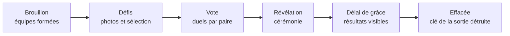

## Qui êtes-vous ? {#qui-etes-vous}

Chaque rôle a son guide : ce qu'il fait dans l'application, ce dont il est responsable, et
ce qu'il doit savoir sur les données des élèves.

| Vous êtes… | Votre guide | En bref |
|---|---|---|
| 🧑‍🏫 **Enseignant** | [Organiser une sortie](./roles/enseignant.md) | Créer la sortie et les défis, inviter les élèves, modérer, animer la cérémonie. |
| 🎒 **Élève, ou parent d'élève** | [Participer](./roles/eleve.md) | Rejoindre la sortie, former une équipe, envoyer des photos, voter. Et ce que deviennent tes données. |
| 🏫 **Chef d'établissement** | [Décider et encadrer](./roles/direction.md) | Responsable de traitement : autoriser l'usage, informer les familles, choisir l'hébergeur. |
| 🛡️ **DPO, référent RGPD ou sécurité** | [Contrôler la conformité](./roles/dpo.md) | Fiche de traitement, mesures techniques, preuves d'effacement, gestion d'incident. |
| 🖥️ **Administrateur (exploitant)** | [Héberger et maintenir](./roles/administrateur.md) | Installer, durcir, sauvegarder, surveiller et mettre à jour l'instance. |

Et pour tous : le [modèle de menaces](./securite/menaces.md) détaille ce qui pourrait mal
tourner — vecteurs d'attaque, compromissions possibles — et ce qui est en place pour s'en
protéger.

## Le principe en une image

Trip Challenges est un logiciel libre (AGPL-3.0), **auto-hébergé** : l'établissement ou son
prestataire l'installe sur ses propres serveurs. Les auteurs du logiciel n'ont accès à
aucune donnée.
