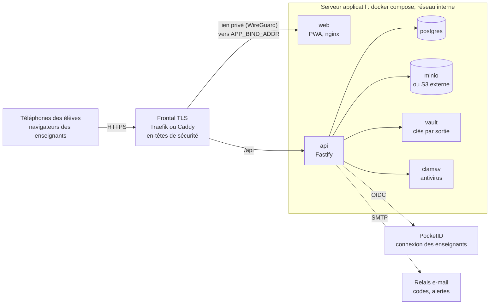

# Guide de l'administrateur (exploitant)

Vous hébergez l'instance pour un ou plusieurs établissements : installation, durcissement,
sauvegardes, surveillance, mises à jour et réponse aux incidents. Si vous êtes extérieur à
l'établissement, vous êtes **sous-traitant** au sens du RGPD.

Les procédures détaillées sont dans le [guide de déploiement](../deployment.md) et le
[guide de durcissement](../production-hardening.md) ; cette page en donne la vue d'ensemble
et les décisions qui vous reviennent.

## Architecture



Seuls `web` et `api` sont exposés, et uniquement à `APP_BIND_ADDR` (l'IP privée vue par le
frontal). Postgres, MinIO, Vault et ClamAV restent sur le réseau interne de compose.

## Liste de contrôle avant la première sortie

- [ ] **HTTPS** sur une seule origine (`/` et `/api`), avec les **en-têtes de sécurité**
  (HSTS, CSP, `frame-ancestors 'none'`…) — fournis par `traefik/dynamic.yml`, à reproduire
  si vous utilisez Caddy ([déploiement § 3B](../deployment.md#3b-une-seule-machine-sur-une-ip-proxy-inverse-sur-la-même-machine)).
- [ ] `APP_BIND_ADDR` sur une IP privée, jamais `0.0.0.0` ; aucun autre port publié.
- [ ] `docker-compose.yml` impose `NODE_ENV=production` à l'API : ne retirez pas cette ligne.
  Vérifiez que `/api/auth/teacher/dev-login` répond 404.
- [ ] **Vault hors du mode dev** : stockage persistant, vrai scellement, jeton restreint, jeton
  root révoqué ([durcissement § 1](../production-hardening.md#1-vault-hors-du-mode-dev)).
- [ ] **Sauvegardes** : Postgres + stockage objet d'un côté, Vault de l'autre, avec des
  accès et des durées distincts ; test de restauration après effacement réalisé
  ([durcissement § 2](../production-hardening.md#2-sauvegardes-et-garantie-deffacement)).
- [ ] **Antivirus** actif (`AV_SCAN_ENABLED=true`), signatures à jour ; test EICAR refusé.
- [ ] **Relais SMTP** : SPF/DKIM configurés (sinon les codes finissent en spam) ; journaux
  conservés moins longtemps qu'une sortie.
- [ ] **Fournisseur d'identité** restreint (voir ci-dessous) ; MFA exigée.
- [ ] **Surveillance** : `/api/readyz` supervisé ; `ALERT_EMAIL` et `HEARTBEAT_URL` définis.
- [ ] `TRUST_PROXY` correspond à l'adresse du frontal (sinon les limites de débit s'appliquent
  à la mauvaise adresse).
- [ ] Images vérifiées avec cosign (voir [Mises à jour](#mises-à-jour)).

## Qui peut être enseignant ?

L'application ne gère pas de liste d'enseignants : **tout compte capable de se connecter au
fournisseur OIDC configuré peut créer des sorties**. Réservez donc l'instance PocketID (ou le
client OIDC) aux personnels concernés : pas d'inscription libre, MFA ou passkeys exigées,
comptes désactivés au départ d'un personnel.

Une session enseignant dure 8 heures. Pour déconnecter **tous** les enseignants d'un coup
(compte compromis), changez `SESSION_SECRET` et redémarrez l'API ; désactivez aussi le compte
dans PocketID.

## Surveillance

| Signal | Où | Réaction |
|---|---|---|
| `/api/readyz` → 503 | sonde du frontal ou de la supervision | Le corps indique la dépendance en panne : `database`, `keystore` (Vault, éventuellement `sealed`), `storage`. |
| Alerte « échec de l'effacement » | e-mail aux enseignants de la sortie et à `ALERT_EMAIL` | Vérifier Vault, le stockage, les journaux de l'API. Tant que l'effacement n'a pas abouti, **les données existent encore**. |
| Silence de `HEARTBEAT_URL` | votre service de « dead man's switch » | Le planificateur est arrêté ou un effacement est bloqué. |
| Envois refusés (`503 scan_unavailable`) | retours des enseignants | clamd est arrêté : les envois restent refusés tant qu'il ne répond pas. |
| Signalement « Référence : … » | message affiché à l'utilisateur | Chercher `"reqId":"…"` dans les journaux de l'API ([durcissement § 5](../production-hardening.md#erreurs-et-identifiants-de-requête-69)). |

## Mises à jour

Les versions sont publiées sur GitHub (notes de version et `CHANGELOG.md`) ; les images
`ghcr.io/fb-univ/trip-api` et `trip-web` sont **signées** :

```bash
cosign verify ghcr.io/fb-univ/trip-api:<version> \
  --certificate-identity-regexp '^https://github\.com/FB-UNIV/trip-challenges/\.github/workflows/release\.yml@refs/heads/main$' \
  --certificate-oidc-issuer https://token.actions.githubusercontent.com
```

Puis `IMAGE_API` / `IMAGE_WEB` dans `.env`, `docker compose pull && docker compose up -d`. Les
migrations de schéma s'appliquent au démarrage ; une migration en échec est annulée et l'API
s'arrête. Sauvegardez la base avant. Suivez les **avis de sécurité** du dépôt (*Watch →
Custom → Security alerts*) : seule la dernière version reçoit des correctifs.

## Incidents

| Situation | Action |
|---|---|
| Photo inappropriée | L'enseignant la retire (Modération ou Élèves). |
| Téléphone d'élève volé | L'élève demande un nouveau code (lien de récupération) : l'utiliser déconnecte l'ancien appareil. |
| Compte enseignant compromis | Désactiver le compte dans PocketID, changer `SESSION_SECRET`, redémarrer l'API. |
| Serveur compromis | Isoler le serveur ; prévenir l'établissement (notification CNIL sous 72 h) ; si nécessaire, **détruire les clés Vault des sorties en cours** ([durcissement § 6](../production-hardening.md#6-effacement-durgence-à-la-demande)). |
| Effacement bloqué | Lire l'erreur dans l'alerte et les journaux ; corriger Vault/stockage ; l'effacement est relancé chaque minute. |
| Faille dans le logiciel | [Signalement privé](https://github.com/FB-UNIV/trip-challenges/security/advisories/new) aux mainteneurs. |

## Préproduction et tests de charge

Une pile de préproduction peut être remplie de sorties de démonstration (`seed-demo`,
uniquement avec `SEED_DEMO=staging`), puis effacée par le chemin normal ; la même commande
prépare un test de charge k6. Voir le [guide de déploiement](../deployment.md#données-de-démonstration-en-préproduction).
